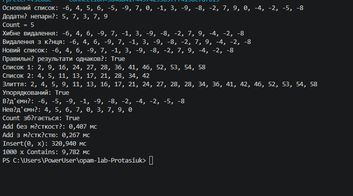

# Лабораторна робота №4

**Тема:** Алгоритми над списками

**Мова програмування:** C#

## Мета роботи

Навчитися реалізовувати та перевіряти алгоритми роботи зі списками, а також порівнювати швидкодію операцій.

## Хід роботи

1. Створено основний список випадкових чисел.
2. Реалізовано відбір додатних непарних чисел і підрахунок їх кількості.
3. Перевірено два способи видалення елементів зі списку.
4. Реалізовано злиття двох упорядкованих списків.
5. Розділено список на від'ємні та невід'ємні числа.
6. Перевірено правильність результатів і виміряно час виконання операцій.

## Результат виконання

Програму успішно запущено. Основні алгоритми працюють правильно, результати перевірок збігаються.

### Скріншот виконання програми

## Висновок

Під час лабораторної роботи закріплено навички роботи зі списками в C#, реалізовано основні алгоритми обробки даних і виконано вимірювання швидкодії операцій.

## Додатково для оцінкі
