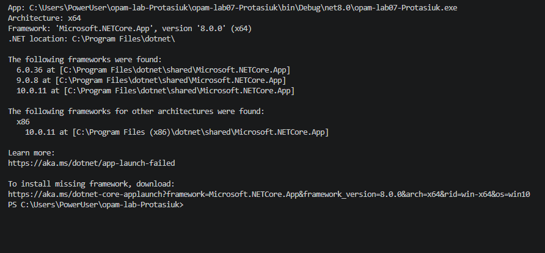

# Лабораторна робота №7
## Узагальнені алгоритми, налаштовані делегатом

N = 20, K = 3, a = 2, b = 0, c = 0

## Мета роботи
Створити узагальнені алгоритми відбору, перетворення, агрегації та групування, які працюють із різними типами даних. Дослідити захоплення змінних у лямбда-виразах.

## Структура проєкту
- `Algorithms.cs` — узагальнені алгоритми `Filter`, `Map`, `Aggregate`, `GroupBy`.
- `Student.cs` — клас-контейнер студента з полями `Name`, `Group`, `Score`.
- `Program.cs` — набори даних, застосування алгоритмів і демонстрація захоплення змінних.

## Запуск
Потрібен .NET SDK 8 або новіший. У каталозі проєкту виконайте:

```bash
dotnet run
```

LINQ не використовується. Тіло кожного узагальненого алгоритму однакове для всіх застосувань.

## Завдання 1. Filter
Для `a = 2`:
- числа: від'ємні або нуль (`x <= 0`);
- рядки: містять дефіс;
- студенти: бал у межах `[60; 89]`.

Тіло `Filter` між трьома застосуваннями змінювалося **0 разів**.

## Завдання 2. Map
Для `b = 0`:
- число → його квадрат;
- рядок → довжина рядка;
- студент → прізвище.

`Map<TIn, TOut>` має два типові параметри, тому може змінювати тип результату.

## Завдання 3. Aggregate
Усі чотири агрегації виконуються через один `Aggregate`, без окремих циклів у місцях виклику.

### Сума
- Стан: поточна сума.
- Старт: `0`.
- Крок: `state + x`.

### Добуток
- Стан: поточний добуток типу `long`.
- Старт: `1`.
- Крок: `state * x`.

### Максимум
- Стан: найбільше значення, знайдене на поточному кроці.
- Старт: `int.MinValue`.
- Крок: якщо `x > state`, повернути `x`, інакше `state`.
- Порожній список: максимум математично не визначений, тому перед викликом перевіряється порожність списку й генерується `InvalidOperationException`.

### Четверта агрегація — кількість чисел, що задовольняють критерій Filter
Оскільки `c = 0`, рахуємо числа, менші або рівні нулю.
- Стан: кількість відповідних елементів.
- Старт: `0`.
- Крок: додати `1`, якщо `x <= 0`, інакше додати `0`.

## Завдання 4. GroupBy
Один `GroupBy<T, TKey>` використано для чотирьох групувань:
1. Студенти за групою.
2. Студенти за першою літерою прізвища.
3. Студенти за діапазоном балів: `0–59`, `60–74`, `75–89`, `90–100`.
4. Рядки за довжиною.

Для кожної групи програма виводить ключ і кількість елементів.

## Завдання 5. Захоплення змінних

Фактичний вивід трьох ситуацій показується програмою під час запуску.

1. **Змінна після лямбди.** Делегат створено, коли поріг дорівнював `K = 3`, але потім змінну змінено на `1000`. Лямбда захоплює змінну, а не копію її початкового значення, тому перевірка `10 > threshold` дає `False`.
2. **Лічильник `for`.** Три делегати повертають `3, 3, 3`, бо всі вони захопили одну змінну циклу `i`. На момент виклику цикл уже завершився, і `i` дорівнює `3`.
3. **Змінна `foreach`.** На сучасних версіях C# результат — `0, 1, 2`, бо кожна ітерація `foreach` має окрему змінну ітерації, яку захоплює відповідна лямбда.

Щоб виправити пункт 2, треба всередині циклу `for` створити локальну копію `int copy = i` і захоплювати `copy`.

## Завдання 6. Висновок

1. Якщо зашивати умови в алгоритм, для трьох критеріїв і трьох типів даних знадобилося б до дев'яти окремих функцій. У цій роботі достатньо одного узагальненого `Filter<T>` і трьох делегатів-критеріїв.
2. Узагальнення було б зайвим для дуже маленького методу, який виконує одну конкретну дію лише з одним конкретним типом і не передбачає повторного використання. Наприклад, окремий метод форматування саме підпису звіту може бути простішим за узагальнений форматувальник.

## результат скріном



## Перевірка крайових випадків

| Вхід | Завдання | Очікувана поведінка |
|---|---|---|
| Порожній список | `Filter` | Порожній список |
| Порожній список | `Map` | Порожній список |
| Порожній список | `Aggregate` для суми | Повертає стартове значення `0` |
| Порожній список | `Aggregate` для максимуму | Максимум не визначений; програма перевіряє порожність і повідомляє про помилку |
| Жоден елемент не підходить | `Filter` | Порожній список |
| Усі елементи в одній групі | `GroupBy` | Один ключ і список усіх елементів |
| Один елемент | Усі алгоритми | Обробляється звичайним способом |

## Висновок
Під час роботи створено бібліотеку узагальнених алгоритмів, яка приймає критерії, перетворення та ключі через делегати. Ті самі алгоритми застосовано до чисел, рядків і студентів без зміни їхнього коду. Також перевірено особливості захоплення змінних у `for` і `foreach`.

# востатнє скідаю макаку

